# Zasiłkowy Przewodnik Przyszłego Rodzica

**Osobista oś czasu od ciąży do powrotu do pracy.** Rodzice mówią, co się u nich dzieje. Aplikacja pokazuje, co im się należy i od kiedy, ile pieniędzy dostaną, kto je wypłaci i jaki wniosek złożyć, gdzie i do kiedy. Gdy coś się zmienia (wcześniak, bliźnięta, utrata pracy, tata przejmuje urlop), oś przelicza się od razu i pokazuje różnicę.

HackNation 2026 · wyzwanie Zakładu Ubezpieczeń Społecznych

**Demo online:** https://przewodnik-rodzica.up.railway.app · **Panel administracyjny:** [/admin](https://przewodnik-rodzica.up.railway.app/admin) · **Zrzuty ekranu:** [docs/prezentacja/zrzuty](docs/prezentacja/zrzuty)

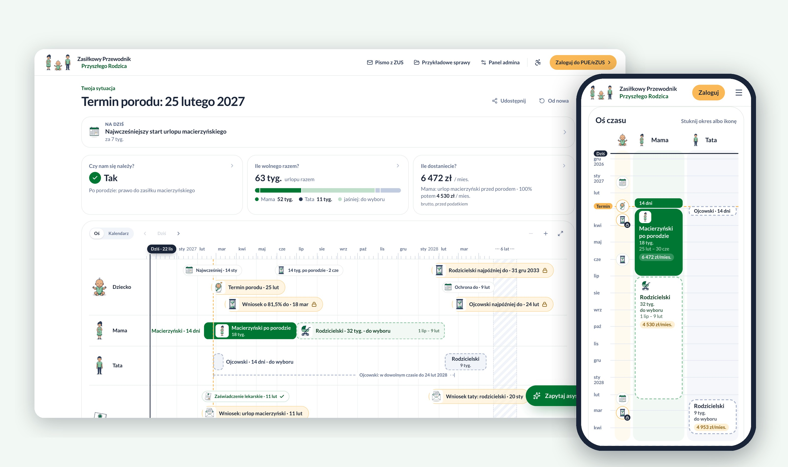

## Problem

- Zasady są rozproszone: Kodeks pracy, ustawa zasiłkowa, rozporządzenia, materiały ZUS.
- Wynik zależy od wielu rzeczy naraz: formy pracy (etat, zlecenie, własna firma), ubezpieczenia chorobowego, liczby dzieci, zarobków i zdarzeń.
- Część decyzji jest nieodwracalna. Wniosek o zasiłek 81,5% można złożyć najpóźniej 21 dni po porodzie, a urlop ojcowski przepada po pierwszych urodzinach dziecka.
- Rodzic nie zna przepisów. Wie tylko, co się u niego dzieje. Brak informacji na wczesnym etapie kończy się odmową albo sporem.

## Rozwiązanie

**Jedna oś czasu zamiast dziesięciu kalkulatorów.** Kilka pytań na start, potem plan:

- **Czy nam się należy?** Tak albo nie, z powodem. Gdy nie, to dlaczego, co przysługuje zamiast tego i co zrobić, żeby przysługiwało.
- **Ile wolnego?** Urlop macierzyński, uzupełniający, rodzicielski i ojcowski, mama i tata osobno, w prawdziwych datach.
- **Ile pieniędzy?** Kwota za każdy okres i miesiąc po miesiącu, z podstawą wymiaru rozpisaną krok po kroku.
- **Kto płaci i co złożyć?** Pracodawca czy ZUS, jaki wniosek, do kogo i do kiedy. Wniosek wypełnia się danymi z planu.
- **Co, jeśli coś pójdzie inaczej?** Test planu na zdarzenia, które mogą się jeszcze zdarzyć, i ryzyka utraty prawa do zasiłku.

Każdy element osi ma dosłowny cytat ze źródła: opisu wyzwania ZUS, Kodeksu pracy, ustawy zasiłkowej, rozporządzeń albo Załącznika ZUS. **Daty i kwoty liczy deterministyczny silnik reguł, nie AI.**

## Jak przetestować

1. Otwórz [demo](https://przewodnik-rodzica.up.railway.app) na komputerze albo telefonie.
2. **„Zaczynamy”**: kilka pytań (kim jesteś, termin porodu albo data urodzenia, praca), potem plan. Skrót „Pobierz dane z ZUS przez mObywatel” wypełnia odpowiedzi danymi przykładowymi.
3. **„Wgraj sprawę z ZUS”**: wybierz jedną z 9 przykładowych rodzin (działa od razu, bez AI) albo wgraj PDF albo zdjęcie sprawy. Aplikacja odczyta fakty, sprawdzi ubezpieczenie chorobowe w dniu powstania prawa, policzy podstawę i kwoty i zestawi wynik z decyzją ZUS. „Pokaż na osi” zamienia sprawę w plan.
4. Na planie: kliknij dowolny okres albo termin (szczegóły ze źródłem), „Dlaczego tyle?” przy pieniądzach, „Wypełnij” przy wniosku, „Co jeśli…” w sekcji „Co może się zmienić”.
5. **[/admin](https://przewodnik-rodzica.up.railway.app/admin)**: zmień wymiar urlopu albo stawkę zasiłku, ustaw datę obowiązywania i zobacz skutki na osi przykładowej rodziny przed zapisem.

## Wymagania wyzwania w aplikacji

| Wymaganie | W aplikacji |
|---|---|
| a) świadczenia w czasie ciąży, także brak uprawnień | zwolnienie lekarskie w ciąży (wynagrodzenie chorobowe, zasiłek chorobowy 100%, limit 270 dni), świadczenie rehabilitacyjne, zasiłek w wysokości zasiłku macierzyńskiego po utracie pracy, zasiłek po ustaniu ubezpieczenia; „nie przysługuje” z powodem i dalszą drogą |
| b) zasiłek macierzyński dla obojga rodziców | okresy i kwoty mamy i taty: macierzyński (20–37 tyg. według liczby dzieci), uzupełniający za pobyt dziecka w szpitalu, rodzicielski (także „Za życiem”), ojcowski, przejęcie urlopu przez tatę, martwe urodzenie i zgon dziecka |
| c) łączenie pracy z urlopem rodzicielskim | praca do pół etatu wydłuża część urlopu, zasiłek za tygodnie pracy jest odpowiednio niższy |
| d) oboje rodzice | podział puli urlopu rodzicielskiego suwakiem, części jednocześnie albo po kolei, plany pod cel, porównanie 100/70% i 81,5% |
| e), j) adopcja i rodzina zastępcza niezawodowa | osobna oś: urlop na warunkach urlopu macierzyńskiego, granice wieku dziecka, urlop rodzicielski, urlop ojcowski ojca adopcyjnego |
| f) indywidualna podstawa wymiaru | z kwoty miesięcznej albo z zarobków miesiąc po miesiącu z zaświadczenia płatnika (Z-3, Z-3a): krótsze ubezpieczenie, miesiące przepracowane w części, premie, najniższa podstawa, górna granica; symulacja na przykładowych sprawach |
| g) dokumenty, terminy, sposób złożenia | wnioski na osi z terminami z Kodeksu pracy, adresat (pracodawca, płatnik albo ZUS), ZAM, ZAS-53, Z-3, Z-3a, e-ZLA; wypełnianie, sprawdzanie i PDF |
| h) zagrożenia i ryzyka | brak ubezpieczenia w dniu porodu, umowa „dla pozoru”, podwyższenie podstawy w ciąży, zadłużenie składkowe przy własnej firmie, punkty bez powrotu z odliczaniem, test odporności planu |
| zintegrowany kalkulator | jedna oś dla wszystkich przypadków; każda zmiana przelicza ją i podświetla różnicę |
| logowanie mObywatel, dane z ZUS, zadłużenie, e-ZLA, PUE/eZUS, wnioski, odpis aktu urodzenia | symulacje, wyraźnie oznaczone w interfejsie, z danymi przykładowymi |
| przekierowanie do ZUS, ministerstwa i PIP | odnośniki w stopce planu |
| panel administracyjny | `/admin`: wymiary urlopów, stawki zasiłku, terminy wniosków; nowa wersja od daty obowiązywania, z podstawą zmiany i podglądem skutków |
| wgranie albo wybór przykładowych wniosków | „Przykładowe sprawy”: wybór, wgranie, sprawdzenie ubezpieczenia i wyliczeń, porównanie z decyzją ZUS |
| RWD | jeden ekran planu dla telefonu i komputera; na telefonie oś ułożona pionowo, szczegóły w arkuszach od dołu |
| wskazanie funkcji z AI | oznaczenie „AI” w interfejsie i sekcja [Sztuczna inteligencja](#sztuczna-inteligencja) niżej |

## Funkcje

### Oś czasu

Ścieżki Dziecko, Mama, Tata, Dokumenty i Pieniądze. Okresy są klipami jak w programie do montażu. Zielony to mama, granatowy to tata, jasny przerywany to „do wyboru”. Kliknięcie otwiera szczegóły: od kiedy, do kiedy, ile, stawka, kwota, kto płaci, jaki wniosek i podstawa prawna z cytatem. Ten sam plan można obejrzeć jako kalendarz z dniami w kolorze tego, kto jest w domu.

| Komputer | Telefon |
|---|---|
| 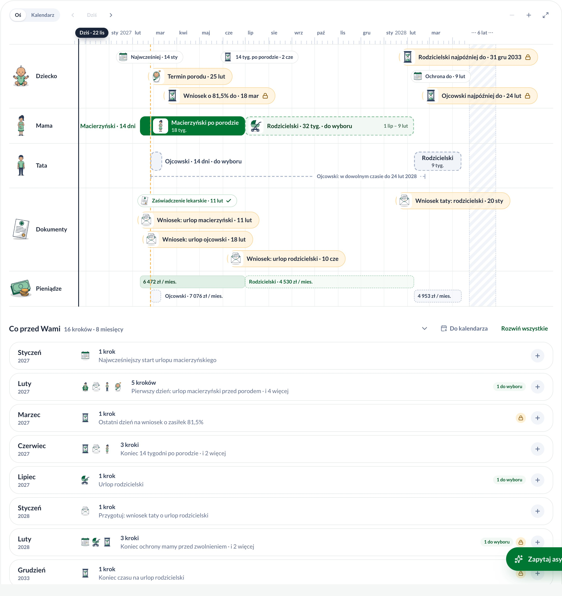 | 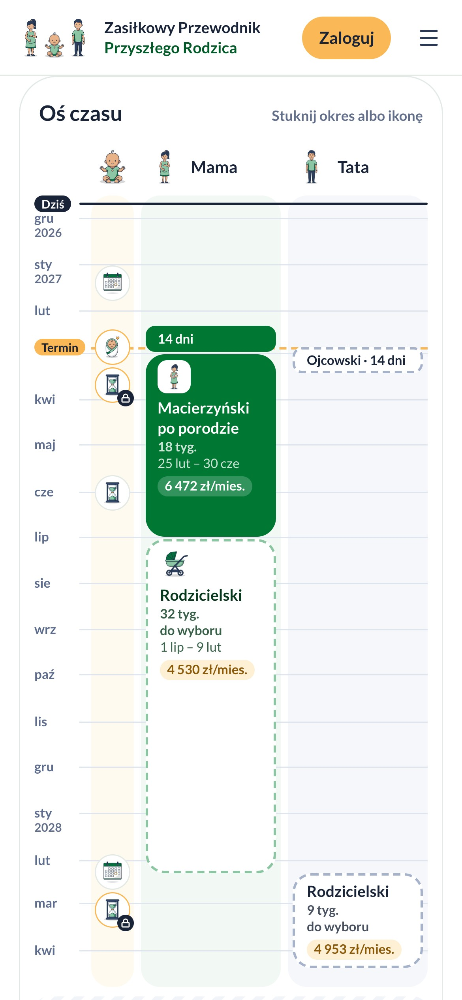 |

### Należy się albo nie, i dlaczego

Odpowiedź dla tej konkretnej rodziny. Gdy zasiłek nie przysługuje, aplikacja mówi, co jest zamiast i co zrobić, żeby przysługiwał. Okno „Dlaczego tak?” rozpisuje przypadek w stałej kolejności: sytuacja, możliwości, co policzyliśmy, co przygotować. Każdy punkt ma źródło.

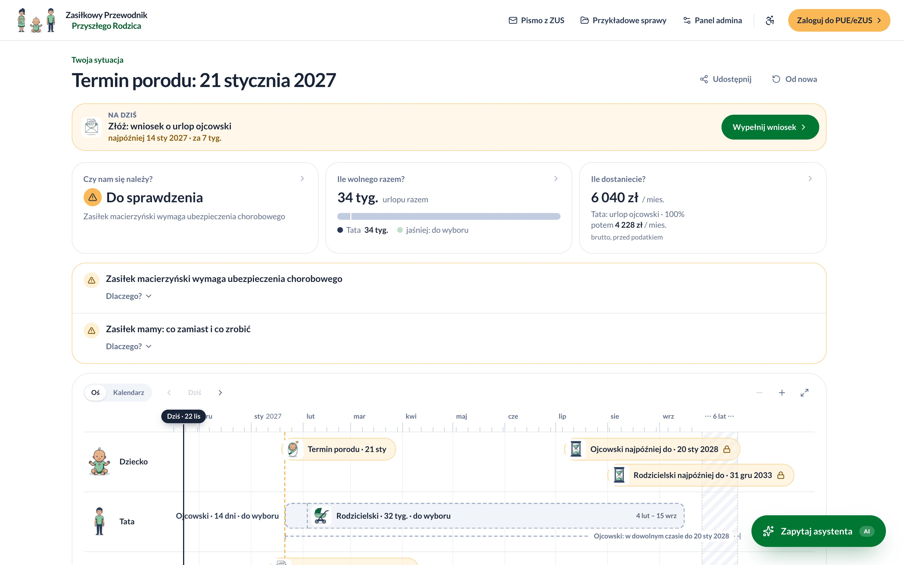 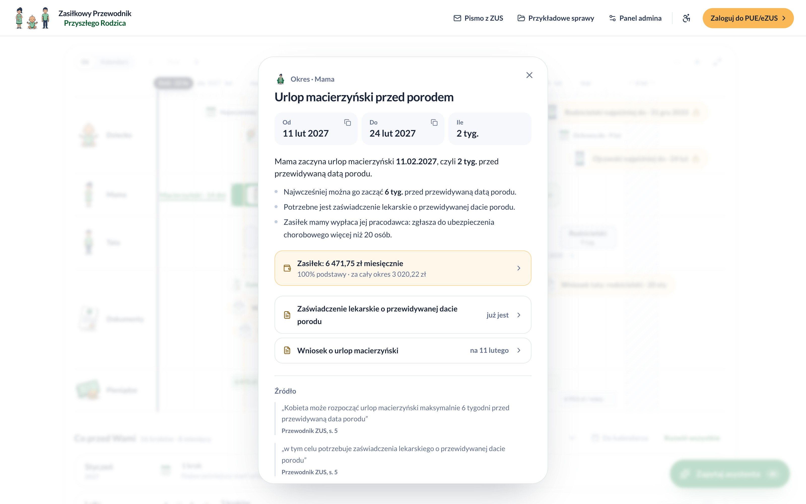

### Pieniądze

Stawki 100%, 70% i 81,5%, kwota za każdy okres, kalendarz wypłat miesiąc po miesiącu (kto wypłaca, kiedy stawka spada) i porównanie wariantów. „Dlaczego tyle?” pokazuje podstawę wymiaru krok po kroku, z przepisem przy każdym kroku.

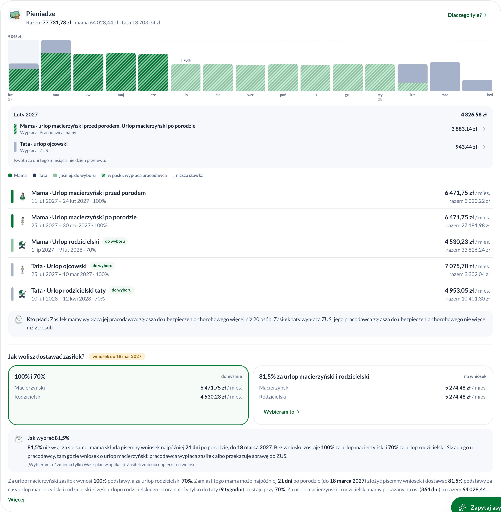 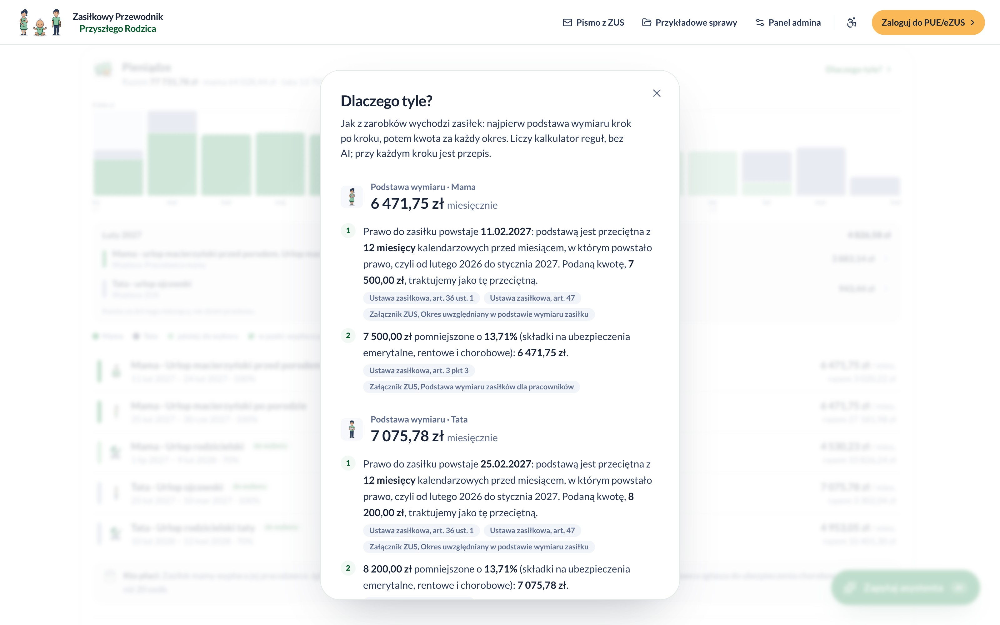

### Wnioski i dokumenty

Lista „co, komu, do kiedy” z terminami z Kodeksu pracy. Wniosek wypełnia się na samym dokumencie: wniosek o urlop jako pismo do pracodawcy, ZAM i ZAS-53 w układzie druku ZUS. To, co wynika z planu, jest już wpisane. „Sprawdź wniosek” wyłapuje braki regułami. Gotowe pismo pobiera się w PDF, a terminy eksportuje do kalendarza. Imię, PESEL i adres zostają w przeglądarce.

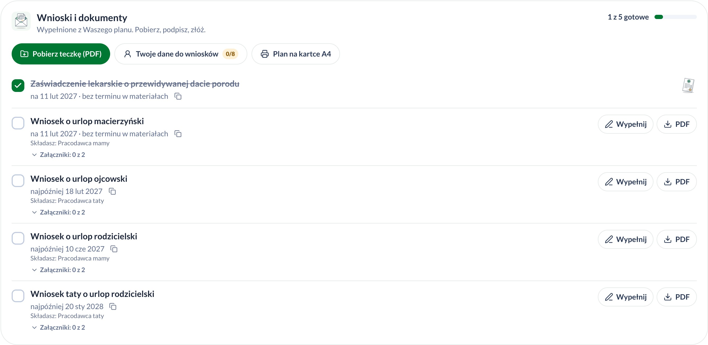 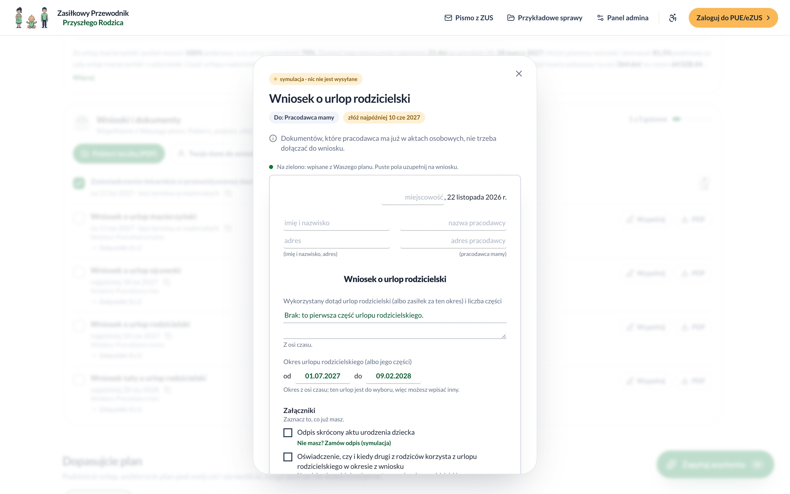

### Zanim coś się wydarzy

- **„Co, jeśli coś pójdzie inaczej?”**: plan przechodzi przez zdarzenia, które mogą się jeszcze zdarzyć (wcześniak, bliźnięta, utrata pracy w ciąży, przejęcie urlopu przez tatę, „Za życiem”). Zdarzenie pokazuje się na prawdziwej osi, stary plan zostaje jako cień, a baner mówi, co się zmienia i o ile.
- **Punkty bez powrotu**: decyzje nieodwracalne jako kłódki z odliczaniem dni.
- **„Na co uważać”**: ryzyka dopasowane do formy pracy.
- **„Nie zostawiajcie tego na stole”**: niewykorzystane uprawnienia w tygodniach i złotych, z ostatnim dniem.
- **Plany dla celu**: najwięcej pieniędzy, najdłużej w domu, równy podział, szybki powrót do pracy. Każdy plan przeliczony silnikiem, jedno kliknięcie układa go na osi.

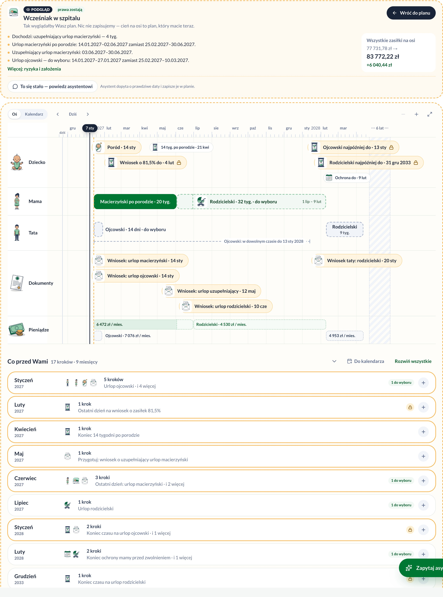 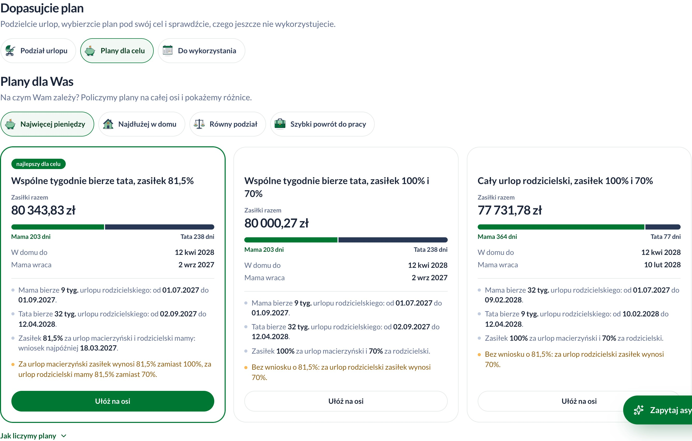

### Przykładowe sprawy ZUS

Wybór albo wgranie sprawy (PDF lub zdjęcie). Model AI przepisuje fakty ze skanu razem z numerami stron, bez imion, nazwisk, PESEL i adresów. Odczyt można poprawić ręcznie. Silnik bez AI sprawdza ubezpieczenie chorobowe w dniu powstania prawa, liczy podstawę z miesięcy z Z-3 i zestawia wynik z decyzją ZUS.

### Panel administracyjny

Zmiana przepisów bez programisty: tygodnie urlopu macierzyńskiego, stawki zasiłku, terminy wniosków. Nowa wersja obowiązuje od wybranej daty, wymaga podstawy zmiany i pokazuje skutki na osi przykładowej rodziny przed zapisem. Historia wersji ze statusem.

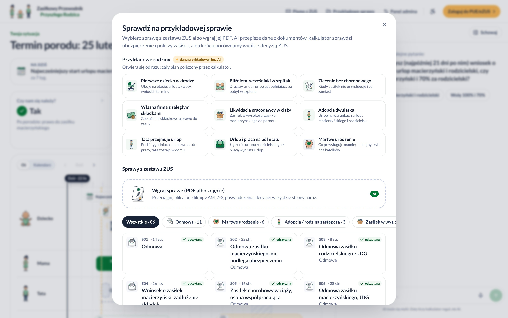 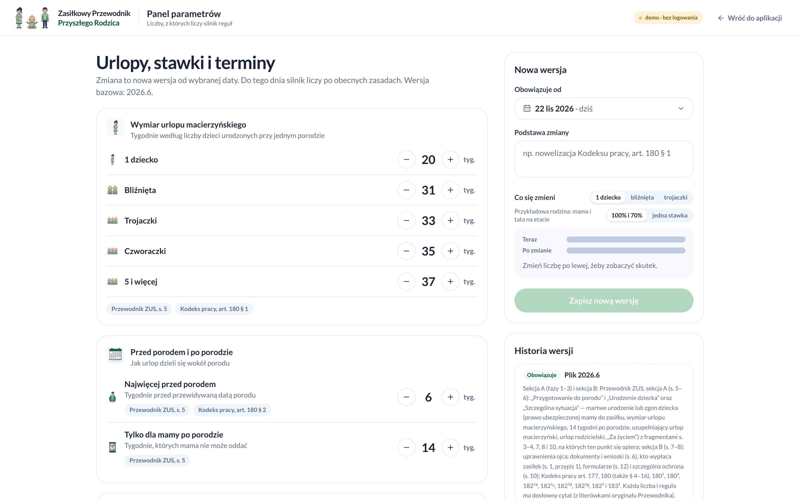

### Na telefonie

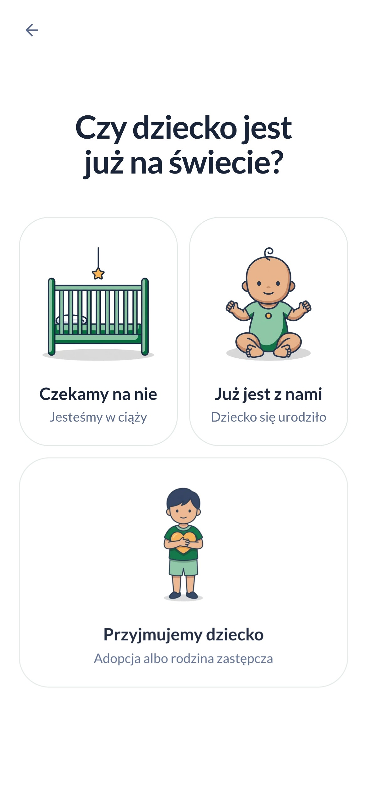 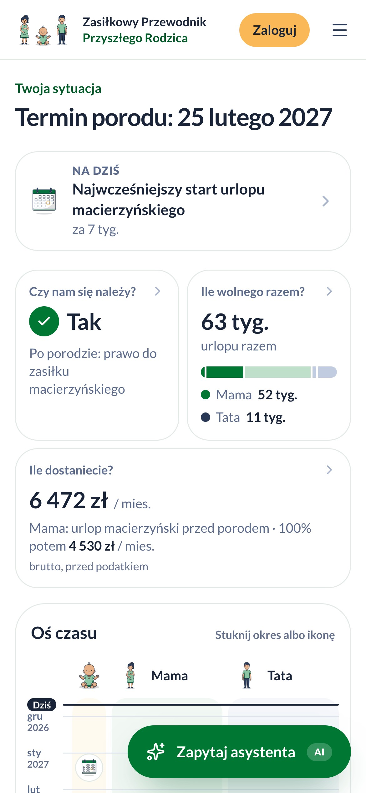 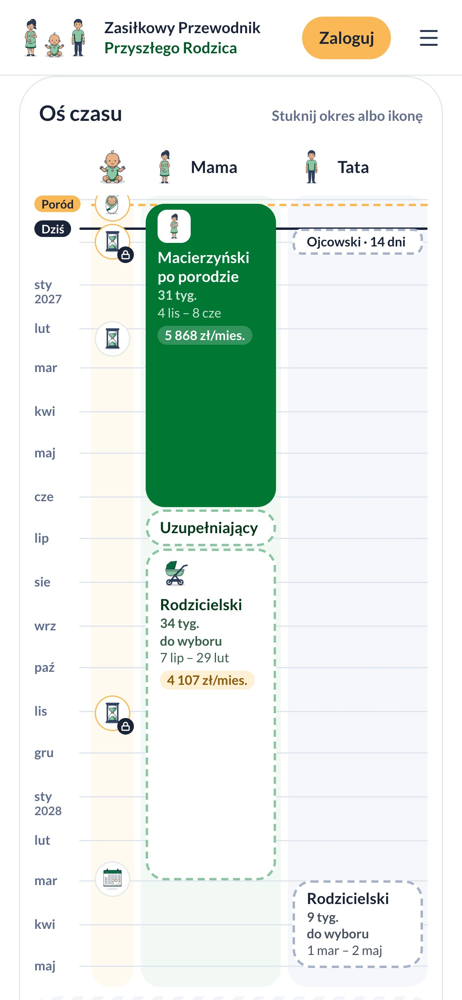 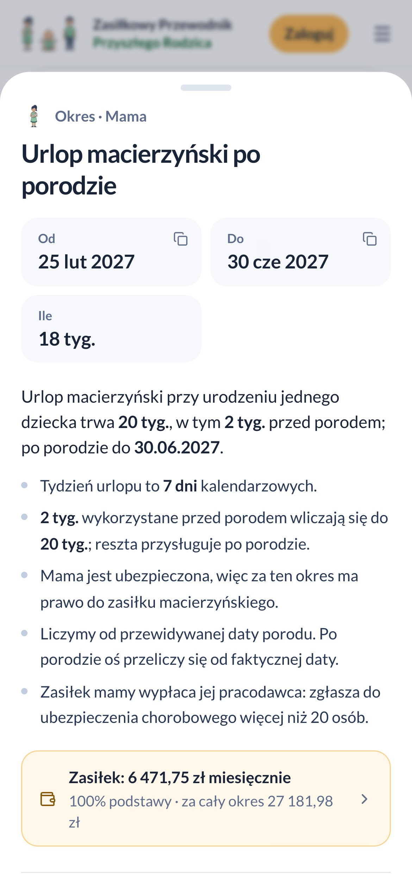 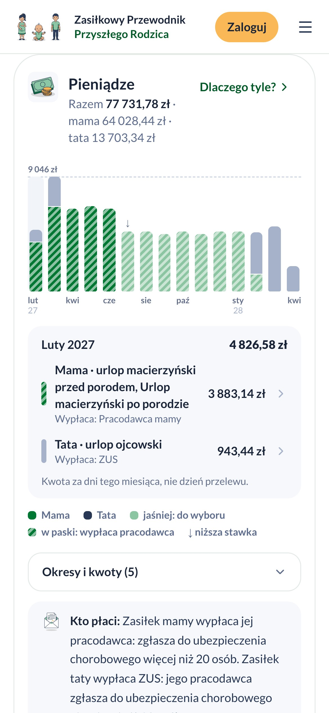

### Dostępność

Prosty język, większy tekst, tryb wysokiego kontrastu, widoczny fokus klawiatury, kontrast tekstu na poziomie WCAG AA, czytanie na głos polskim głosem urządzenia. Animacje pokazują zmianę, nie zdobią, i respektują ustawienie ograniczenia ruchu. Po stracie dziecka plan przechodzi w tryb łagodny: bez kafelków i optymalizacji, tylko to, co przysługuje.

## Wiarygodność wyliczeń

- **Liczy silnik reguł**: czysty, deterministyczny moduł w Pythonie, bez bazy i bez AI. Te same odpowiedzi zawsze dają tę samą oś.
- **Każda reguła ma źródło**: dosłowny cytat z numerem strony albo artykułu. Test automatyczny sprawdza każdy cytat co do znaku i co do strony.
- **Ponad 2 500 testów automatycznych**: oczekiwane daty i kwoty są w nich policzone ręcznie z przepisów.
- **Zgodność z decyzjami ZUS**: 53 z 59 przykładowych spraw z jednoznacznym rozstrzygnięciem.
- **Parametry to dane**: wszystkie liczby (tygodnie, stawki, terminy, limity) są w pliku parametrów i w panelu, każda ze źródłem.

## Sztuczna inteligencja

Każda funkcja AI jest oznaczona w interfejsie. **AI nigdy nie liczy dat ani kwot i nie ustala prawa do zasiłku.**

| Funkcja | AI | Rola |
|---|---|---|
| Asystent w czacie | tak | prowadzi rozmowę po jednym pytaniu, zapisuje odpowiedzi narzędziami, które wołają silnik, i tłumaczy oś prostym językiem z cytatami; treść i kolejność pytań ustala kod |
| Odczyt przykładowej sprawy ze skanu | tak | przepisuje fakty z obrazu strony razem z numerami stron, z możliwością ręcznej poprawki |
| „Pismo z ZUS” | tak | ze zdjęcia albo PDF pisma mówi prostym językiem, co to za pismo, co zrobić i do kiedy; daty tylko przepisane z pisma, nic nie jest zapisywane |
| Sprawdzenie wniosku | nie | reguły; AI na życzenie tylko przeredagowuje komunikaty |
| Daty, okresy, kwoty, prawo do zasiłku, podstawa wymiaru | nie | silnik reguł |
| Plany dla celu, test odporności, kalendarz wypłat, ocena sprawy | nie | silnik reguł |
| Ilustracje w interfejsie | tak | wygenerowane modelem obrazów (`tools/illustrations/`); w aplikacji to zwykłe pliki |

Modele: Claude (Anthropic) przez [Pydantic AI](https://ai.pydantic.dev); dostawcę i model ustawia się w konfiguracji (Anthropic, Google Gemini albo OpenRouter). Skany spraw czyta wyłącznie Claude albo Gemini.

**AI w procesie tworzenia:** kod aplikacji powstawał z pomocą asystentów AI do programowania (Claude Code), a ilustracje wygenerował model obrazów.

## Architektura

```
Przeglądarka (React, telefon i komputer)
        │  REST API /api/*  (JSON, strumień NDJSON dla czatu)
        ▼
FastAPI (Python)
  ├── engine/      silnik reguł: Scenario → Timeline (okresy, terminy, dokumenty, kwoty, wyjaśnienie ze źródłami)
  ├── assistant/   czat: Pydantic AI, narzędzia zmieniające scenariusz
  ├── cases/       przykładowe sprawy: odczyt skanu, ocena, porównanie z decyzją ZUS
  ├── params/      parametry 2026 ze źródłami + wersje z panelu od daty obowiązywania
  └── Supabase (Postgres): rozmowy i wersje parametrów
```

- **Frontend**: React 19, TypeScript, Vite, Tailwind CSS 4, Motion, komponenty Spectrum UI, kolory zieleni i bieli ZUS, font Lato.
- **Backend**: Python 3.13, FastAPI, Pydantic, uv. Silnik dostaje parametry jako argument, więc zmiana przepisów nie wymaga zmiany kodu.
- **Baza**: Supabase (Postgres), schemat wyłącznie przez migracje SQL, RLS na każdej tabeli. Bez Supabase rozmowy zapisują się w plikach.
- **Wdrożenie**: jeden kontener (`Dockerfile`, `railway.json`). FastAPI serwuje też zbudowany frontend.

## Uruchomienie lokalne

Wymagania: Node.js 20.19+ (zalecany 24) z npm, [uv](https://docs.astral.sh/uv/) (sam pobierze Pythona 3.13), Docker tylko do lokalnej bazy.

```bash
npm run setup                          # zależności: frontend, CLI Supabase, backend
cp backend/.env.example backend/.env   # klucz modelu AI (opcjonalnie)
npm run dev                            # API na :8000 + frontend na :5173
```

Otwórz http://localhost:5173. Bez klucza modelu asystent jest wyłączony, a oś, kalkulator, przykładowe rodziny i panel działają. Dokumentacja API: http://localhost:8000/docs.

| Komenda | Co robi |
|---|---|
| `npm run dev` | backend (FastAPI, :8000) i frontend (Vite, :5173) naraz |
| `npm test` | testy backendu: reguły z ręcznie policzonymi datami i kwotami, dosłowność cytatów, API |
| `npm run lint` | ruff, oxlint i sprawdzenie typów TypeScript |
| `npm run build` | build frontendu |
| `npm run db:start`, `db:status`, `db:reset` | lokalny Supabase w Dockerze |
| `cd backend && uv run python -m app.cases.batch --only-cached` | zgodność z decyzjami ZUS na przeczytanych sprawach, bez AI |

## Struktura repozytorium

```
backend/    FastAPI: app/api (REST), app/engine (silnik reguł), app/assistant (czat),
            app/cases (przykładowe sprawy), params/2026.json (parametry ze źródłami), tests/
frontend/   React: onboarding, ekran planu z osią czasu, czat, panel /admin
supabase/   migracje SQL
tools/      tekst źródeł do cytowania, test asystenta na prawdziwym modelu, generator ilustracji
docs/       opis wyzwania, prezentacja i zrzuty ekranu
```

Dokumentacja dla programistów: [CLAUDE.md](CLAUDE.md).

## Dane

Materiały i przykładowe sprawy od ZUS nie są częścią repozytorium: zespół trzyma je lokalnie, poza gitem. Odczyty spraw zapisują się tylko na serwerze aplikacji, poza repozytorium. Przykładowe rodziny i dane w symulacjach są syntetyczne.
